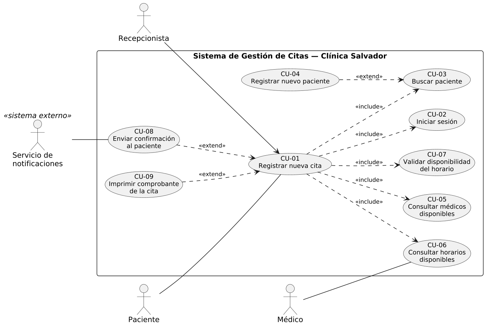
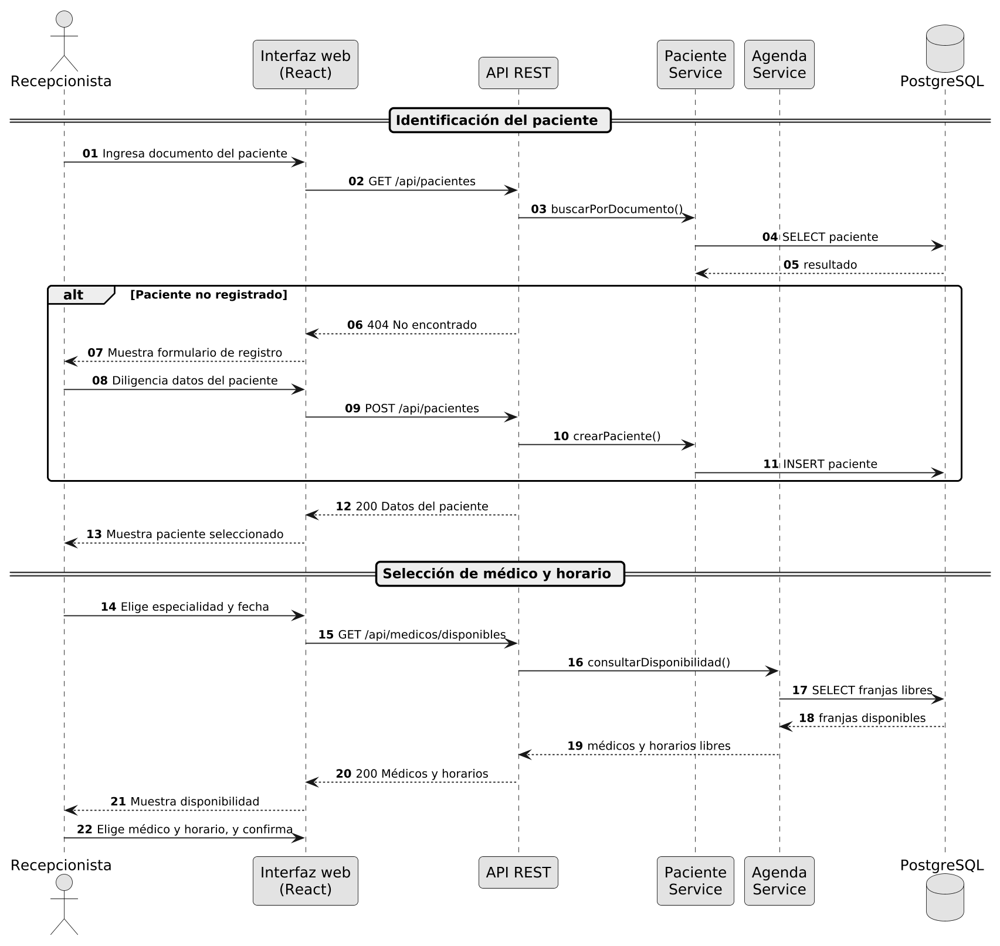
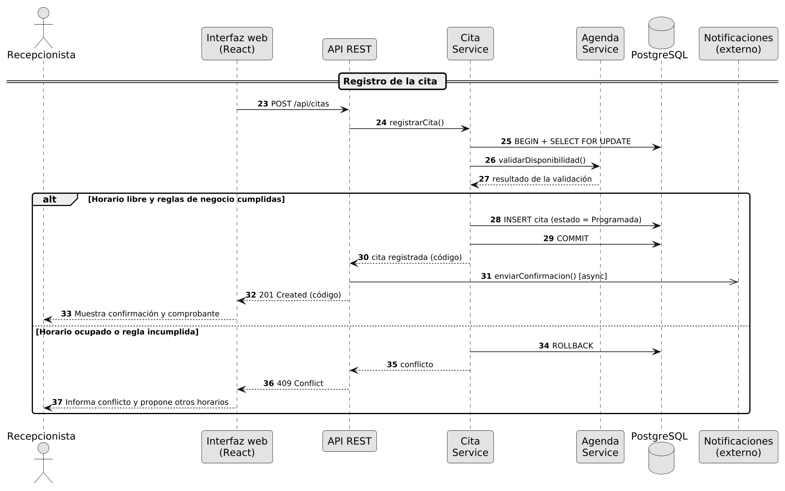
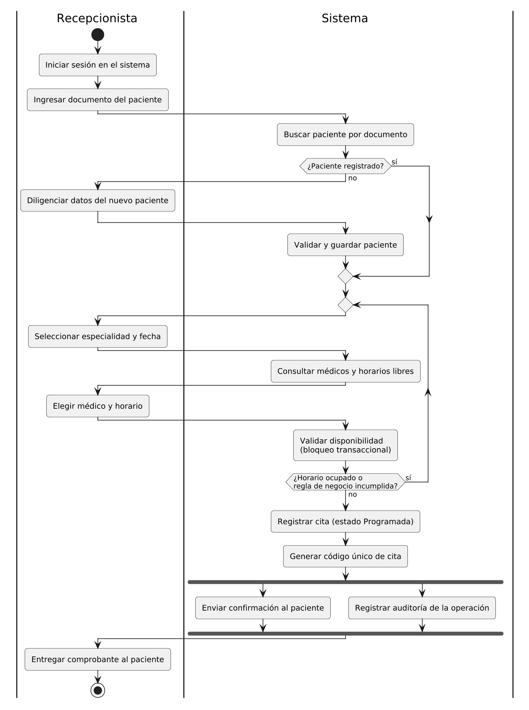
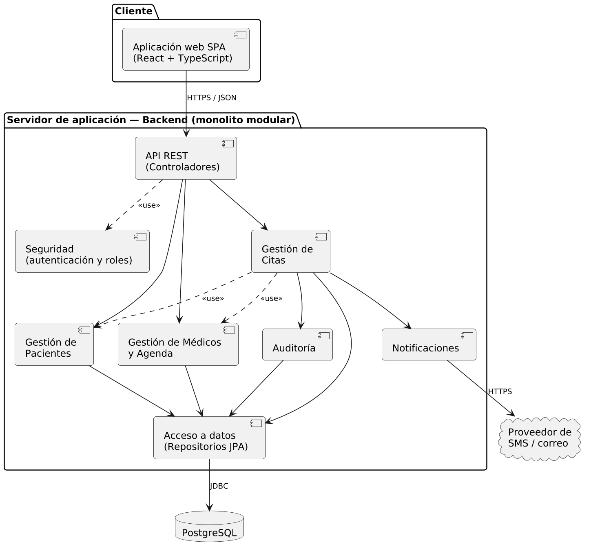
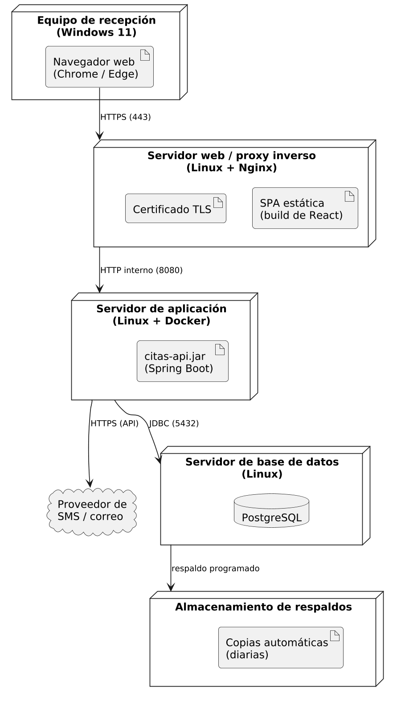
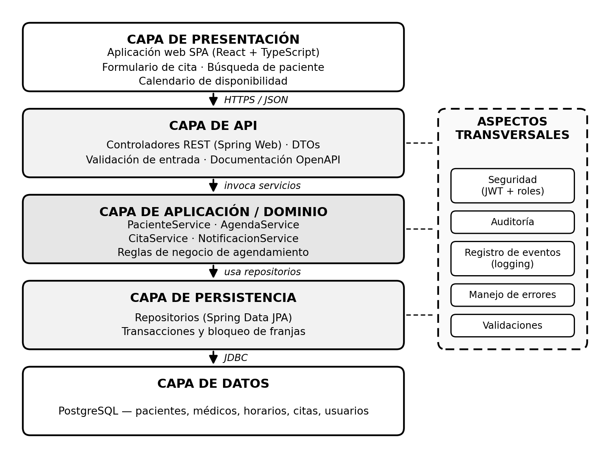
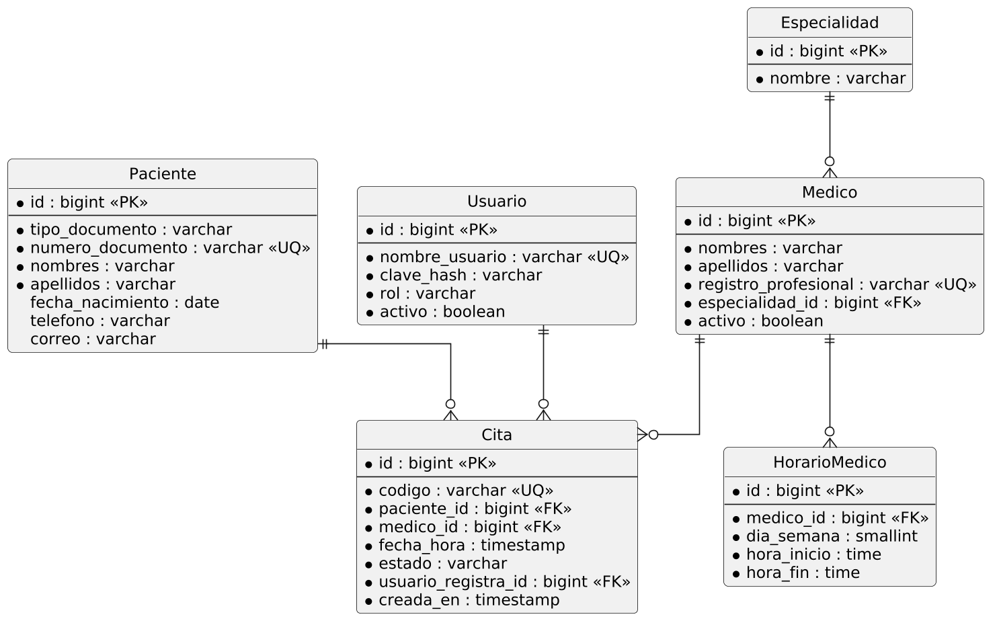

# Análisis y diseño del registro de citas médicas

**Clínica Salvador · Ingeniería de Software · Universidad de Cartagena**

**Autor:** Jesus David Campo Yunes

**Actividad:** Unidad dos — Análisis y diseño de la funcionalidad «Registrar nueva cita médica»

**Fecha:** Octubre de 2026

Este repositorio reúne el informe académico, los diagramas y sus fuentes editables. El trabajo estudia cómo un recepcionista registra una cita para un paciente, selecciona un médico y un horario disponible y confirma la reserva evitando cruces de agenda.

## Documento principal

[Descargar el informe completo en Word](documentos/Analisis_Diseno_Registro_Cita_Clinica_Salvador_Campo_Yunes.docx)

El informe contiene el análisis de requisitos, las reglas de negocio, los casos de uso, el diseño UML, la arquitectura propuesta, el contrato de la API, el modelo de datos y las referencias bibliográficas.

## Organización

```text
Diagramas-Clinica-Salvador/
├── README.md
├── documentos/
│   └── Analisis_Diseno_Registro_Cita_Clinica_Salvador_Campo_Yunes.docx
├── diagramas/
│   ├── 01_casos_uso.png
│   ├── 02a_secuencia_parte1.png
│   ├── 02b_secuencia_parte2.png
│   ├── 03_actividad.png
│   ├── 04_componentes.png
│   ├── 05_despliegue.png
│   ├── 06_arquitectura.png
│   └── 07_modelo_datos.png
└── fuentes/
    ├── plantuml/  # Siete diagramas editables en .puml
    └── python/    # Script de la arquitectura en capas
```

## Índice de diagramas

| Diagrama | Imagen | Fuente editable |
| --- | --- | --- |
| Casos de uso | [Ver](diagramas/01_casos_uso.png) | [PlantUML](fuentes/plantuml/01_casos_uso.puml) |
| Secuencia: identificación y selección | [Ver](diagramas/02a_secuencia_parte1.png) | [PlantUML](fuentes/plantuml/02a_secuencia_parte1.puml) |
| Secuencia: registro y confirmación | [Ver](diagramas/02b_secuencia_parte2.png) | [PlantUML](fuentes/plantuml/02b_secuencia_parte2.puml) |
| Actividad | [Ver](diagramas/03_actividad.png) | [PlantUML](fuentes/plantuml/03_actividad.puml) |
| Componentes | [Ver](diagramas/04_componentes.png) | [PlantUML](fuentes/plantuml/04_componentes.puml) |
| Despliegue | [Ver](diagramas/05_despliegue.png) | [PlantUML](fuentes/plantuml/05_despliegue.puml) |
| Arquitectura en capas | [Ver](diagramas/06_arquitectura.png) | [Python](fuentes/python/06_arquitectura.py) |
| Modelo de datos | [Ver](diagramas/07_modelo_datos.png) | [PlantUML](fuentes/plantuml/07_modelo_datos.puml) |

## Galería

### Casos de uso



### Secuencia — Identificación del paciente y selección de horario



### Secuencia — Registro y confirmación



### Actividad



### Componentes



### Despliegue



### Arquitectura en capas



### Modelo de datos



## Edición de las fuentes

Los archivos de `fuentes/plantuml/` se pueden abrir con PlantUML o con una extensión compatible de Visual Studio Code.

La arquitectura se genera con Python y Matplotlib. Desde la raíz del repositorio:

```bash
python -m pip install -r fuentes/python/requirements.txt
python fuentes/python/06_arquitectura.py
```

El script guarda su resultado en `diagramas/06_arquitectura.png`.

## Alcance del trabajo

La entrega corresponde al análisis y diseño académico de una funcionalidad. React, Spring Boot y PostgreSQL forman parte de la propuesta arquitectónica descrita en el informe; este repositorio contiene la documentación y los diagramas, sin una aplicación implementada.

Los supuestos y hallazgos del caso requieren validación con los interesados de la clínica, tal como se indica en el documento.
